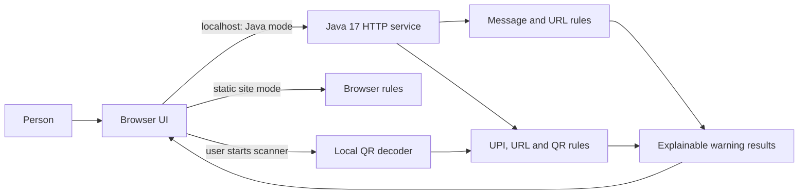

# ScamSathi — Pause. Check. Protect.

ScamSathi is a local-first cyber-safety prototype for Indian communities and small businesses. It checks message text, URLs, and decoded QR content for explainable warning patterns, then gives practical next steps. It does not claim to prove fraud or that a low score means safe.

**Hackathon:** VibeX Codes 26 · Track 3 — Cyber Safety

**Repository:** https://github.com/ada203880-boop/scamsathi-vibex26

**Live demo:** https://ada203880-boop.github.io/scamsathi-vibex26/

## What works

- English, Hindi, and Odia interface; selected Hindi scam phrases are included in the rules.
- Message and optional URL checks with visible reasons, rule points, and safer next steps.
- URL structure inspection without visiting the destination.
- Camera, image-upload, and pasted-text QR flows; QR destinations are displayed as text and never opened. Camera checks require HTTPS or localhost and the user's permission.
- UPI payload parsing that displays the encoded payee and amount as **unverified data**.
- A session-only dashboard. It counts checks in the current tab without retaining message content.
- Local Java 17+ service, plus a static browser-only rules fallback for GitHub Pages.
- No external runtime API, trained fraud model, reputation lookup, or audio detector.

The full feature-by-feature audit is in [docs/FEATURE_STATUS.md](docs/FEATURE_STATUS.md). See [docs/PRIVACY.md](docs/PRIVACY.md), [docs/SECURITY.md](docs/SECURITY.md), and [docs/ML_METHODOLOGY.md](docs/ML_METHODOLOGY.md) before using the prototype with real content.

## Quick start

### Windows

1. Install Java 17 or later (both `java` and `javac` must be on `PATH`).
2. Double-click `run.bat`.
3. Open `http://127.0.0.1:18878`.

### macOS or Linux

Install Java 17 or later, then run:

```sh
chmod +x run.sh
./run.sh
```

Open `http://127.0.0.1:18878`. Set `PORT` to choose another port. The service binds to loopback only.

## Try the demo

Use the **Try a sample message** button and analyze the synthetic KYC example. Review the matched indicators and safer actions. For the UPI example, open **Learn the signs**, select the UPI refund scenario, and analyze its text. Open **Scan a QR** and paste a synthetic `upi://pay?...` payload. No sample contains a real account, QR destination, or payment.

## Architecture



The public static site runs the JavaScript rules in the visitor's browser. Running `run.bat` or `run.sh` uses the Java API on the same device. Neither mode sends URLs to a reputation service. More detail is in [docs/ARCHITECTURE.md](docs/ARCHITECTURE.md) and [docs/API.md](docs/API.md).

## Verify the project

```sh
npm test
```

The tests cover rule behavior and local Java API/static-serving smoke checks. Run details and limitations are in [docs/TESTING.md](docs/TESTING.md). A passing test suite does not measure real-world fraud-detection accuracy.

## Hackathon submission

- **Deck:** [presentation/ScamSathi_VibeX_Final.pptx](presentation/ScamSathi_VibeX_Final.pptx) — 10 slides, matching the guide's 8–10 slide limit.
- **Demo narration:** [presentation/DEMO_SCRIPT.md](presentation/DEMO_SCRIPT.md).
- **Submission notes:** [SUBMISSION-GUIDE.md](SUBMISSION-GUIDE.md).
- **Third-party code:** local QR decoder `qr-scanner` 1.4.2 (MIT), with notices in [THIRD-PARTY-NOTICES.md](THIRD-PARTY-NOTICES.md).

## Limitations and disclosure

ScamSathi is an explainable prototype, not a production fraud service. The weighted signal score is not a probability or verdict. Heuristic coverage is narrow and can miss scams or flag legitimate content. It does not monitor calls, analyze audio, verify banks or payees, check domain reputation, expand redirects, block transactions, or file reports. Audio analysis and validated ML are unavailable; no model metrics are claimed. Odia UI is translated, but Odia scam-text detection is not implemented.

The VibeX materials specify 8–10 slides and ask participants to disclose pre-existing code, third-party resources, and AI tools. This repository contains pre-event work; describe that timing accurately and confirm eligibility with the organizer before submitting. OpenAI Codex assisted with code review, implementation, verification, and deck/document updates for this submission. Disclose any other tools used by the team. See [the event page](https://api.unstop.com/hackathons/vibex-codes-26-globalyogacourse-1766232) for current submission details.

If money has left an account in India, contact the bank promptly and report through the official [National Cyber Crime Reporting Portal](https://cybercrime.gov.in/). The app displays 1930 for financial cyber fraud; confirm current guidance on the official portal.
