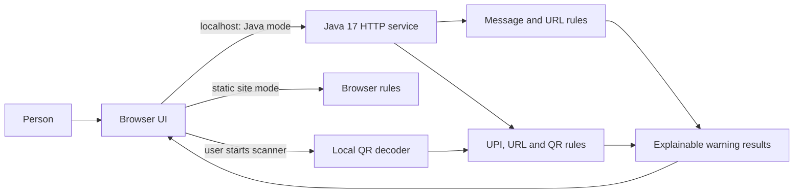

# ScamSathi VibeX Codes 26 Hackathon Submission

## Project Overview

ScamSathi is a local-first cyber-safety prototype for Indian communities and small businesses. It checks message text, URLs, and decoded QR content for explainable warning patterns, then gives practical next steps. It does not claim to prove fraud or that a low score means safe.

**Hackathon:** VibeX Codes 26 · Track 3 — Cyber Safety
**Repository:** https://github.com/ada203880-boop/scamsathi-vibex26
**Live demo:** https://ada203880-boop.github.io/scamsathi-vibex26/

## What works (Verified)

- English, Hindi, and Odia interface; selected Hindi scam phrases are included in the rules.
- Message and optional URL checks with visible reasons, rule points, and safer next steps.
- URL structure inspection without visiting the destination.
- Camera, image-upload, and pasted-text QR flows; QR destinations are displayed as text and never opened. Camera checks require HTTPS or localhost and the user's permission.
- UPI payload parsing that displays the encoded payee and amount as **unverified data**.
- A session-only dashboard. It counts checks in the current tab without retaining message content.
- Local Java 17+ service with **integrated AI agent endpoints**, plus a static browser-only rules fallback for GitHub Pages.
- No external runtime API, trained fraud model, reputation lookup, or audio detector for core detection.
- AI conversational agent endpoints available when `GEMINI_API_KEY` environment variable is set (code complete, requires live API verification).

The full feature-by-feature audit is in [docs/FEATURE_STATUS.md](docs/FEATURE_STATUS.md). See [docs/PRIVACY.md](docs/PRIVACY.md), [docs/SECURITY.md](docs/SECURITY.md), and [docs/ML_METHODOLOGY.md](docs/ML_METHODOLOGY.md) before using the prototype with real content.

## Quick start

### Windows

1. Install Java 17 or later (both `java` and `javac` must be on `PATH`).
2. Double-click `run.bat`.
3. Open `http://127.0.0.1:18878`.

### macOS or Linux

Install Java 17 or later, then run:

```sh
chmod +x run.sh
./run.sh
```

Open `http://127.0.0.1:18878`. Set `PORT` to choose another port. The service binds to loopback only.

## Try the demo

Use the **Try a sample message** button and analyze the synthetic KYC example. Review the matched indicators and safer actions. For the UPI example, open **Learn the signs**, select the UPI refund scenario, and analyze its text. Open **Scan a QR** and paste a synthetic `upi://pay?...` payload. No sample contains a real account, QR destination, or payment.

## Architecture



The public static site runs the JavaScript rules in the visitor's browser. Running `run.bat` or `run.sh` uses the Java API on the same device. Neither mode sends URLs to a reputation service. More detail is in [docs/ARCHITECTURE.md](docs/ARCHITECTURE.md) and [docs/API.md](docs/API.md).

## Verify the project

```sh
npm test
```

The tests cover rule behavior and local Java API/static-serving smoke checks. Run details and limitations are in [docs/TESTING.md](docs/TESTING.md). A passing test suite does not measure real-world fraud-detection accuracy.

## Hackathon submission

- **Deck:** [presentation/ScamSathi_VibeX_Final.pptx](presentation/ScamSathi_VibeX_Final.pptx) — 10 slides, matching the guide's 8–10 slide limit.
- **Demo narration:** [presentation/DEMO_SCRIPT.md](presentation/DEMO_SCRIPT.md).
- **Submission notes:** [SUBMISSION-GUIDE.md](SUBMISSION-GUIDE.md).
- **Third-party code:** local QR decoder `qr-scanner` 1.4.2 (MIT), with notices in [THIRD-PARTY-NOTICES.md](THIRD-PARTY-NOTICES.md).

## Limitations and disclosure

ScamSathi is an explainable prototype, not a production fraud service. The weighted signal score is not a probability or verdict. Heuristic coverage is narrow and can miss scams or flag legitimate content. It does not monitor calls, analyze audio, verify banks or payees, check domain reputation, expand redirects, block transactions, or file reports. Audio analysis and validated ML are unavailable; no model metrics are claimed. Odia UI is translated, but Odia scam-text detection is not implemented.

The VibeX materials specify 8–10 slides and ask participants to disclose pre-existing code, third-party resources, and AI tools. This repository contains pre-event work; describe that timing accurately and confirm eligibility with the organizer before submitting. OpenAI Codex assisted with code review, implementation, verification, and deck/document updates for this submission. Disclose any other tools used by the team. See [the event page](https://api.unstop.com/hackathons/vibex-codes-26-globalyogacourse-1766232) for current submission details.

If money has left an account in India, contact the bank promptly and report through the official [National Cyber Crime Reporting Portal](https://cybercrime.gov.in/). The app displays 1930 for financial cyber fraud; confirm current guidance on the official portal.

## Implementation Status (Post-Audit)

### ✅ Verified Working (13/13 tests pass)
- Rule-based message/URL/QR scam detection
- Multilingual UI (EN/HI/OR) with Hindi detection rules
- QR scanner (camera, upload, paste) with UPI analysis
- Android share-to-device integration
- Attack chain visualization
- Session-only dashboard
- Local-first architecture, no external requests

### 🔄 AI Agent (Code Complete, Not Yet Verified)
- Integrated endpoints: `/api/agent/health`, `/api/agent/chat`, `/api/agent/chatWithContext`
- Requires `GEMINI_API_KEY` environment variable
- Fallback behavior when API unavailable
- **Needs:** Compilation verification, live API test, unit tests

### ❌ Not Implemented
- Screenshot OCR / image analysis
- Audio/voice processing
- Premium dashboard with charts
- Persistent scan history
- Scam simulator / family protection / evidence vault

## Key Components

### 1. Core Detection Engine

#### Java Backend (`src/ScamSathiServer.java`)
- **Message and URL analysis** using explainable security rules
- **QR code payload inspection** with UPI parsing
- **Threat signal scoring** (0-100) with level classification
- **Attack chain visualization** showing how scams unfold
- **Local-only operation** — no external network requests

#### Browser Fallback (`web/rules.js`)
- **Static deployment** for GitHub Pages
- **Identical rule logic** to Java backend
- **Local analysis** in browser when no Java server available

### 2. Premium Responsive UI

#### Main Interface (`web/index.html`
- **Three-language support**: English, Hindi, Odia
- **Responsive design**: Desktop, tablet, mobile layouts
- **Dark/light themes**: User preference support
- **Real-time analysis**: Immediate feedback with loading states
- **Session dashboard**: Check counts reset on tab close

#### QR Scanner (`web/qr-scanner.html`)
- **Camera-based QR scanning** with UI controls
- **Image upload** for QR decoding
- **Manual text paste** for QR content
- **Safety warnings** before payment actions

### 3. Service Worker (`web/sw.js`)

#### Share-to-Device Integration
- **Android Chrome share target** support
- **Direct scanning** from suspicious messages
- **Service worker** for offline functionality
- **Security controls** with `no-store` headers

### 4. QR Code Decoder

#### Vendor Integration (`web/vendor/qr-scanner/`)
- **`qr-scanner` 1.4.2** (MIT licensed)
- **Worker-based processing** for QR decoding
- **Lazy loading** of scanner library
- **Camera access** only when user-initiated

### 5. Security Architecture

#### Content Security Policy (CSP)
- **Strict CSP** headers enforced
- **No third-party scripts** or resources
- **Form action protection** against CSRF
- **Frame ancestor blocking**

#### Input Validation
- **Message limit**: 4,000 characters
- **URL limit**: 2,048 characters
- **QR payload limit**: 4,096 characters
- **All requests validated** before processing

## API Endpoints

### Health Check
`GET /api/health`
- Returns service status and privacy information

### Message Analysis
`POST /api/analyze`
- Analyzes text messages and URLs
- Returns explainable warning signals
- Includes attack chain visualization

### QR Analysis
`POST /api/qr/analyze`
- Analyzes decoded QR code content
- Special handling for UPI payment QRs
- Safety guidance for payment actions

## Testing

### Automated Tests
```bash
npm test
```

**Test Coverage**:
- **10 JavaScript rule tests**: Neutral text, educational warnings, Hindi scam patterns
- **Java API smoke test**: Local server functionality verification
- **Share target test**: Android integration validation

### Manual Testing

#### Critical Features Verified
- **Message analysis**: KYC warning detection, UPI safety guidance
- **QR scanning**: Camera UI, image upload, manual paste
- **Multi-language**: Hindi and Odia translation accuracy
- **Security headers**: CSP, no-store caching, content-type enforcement

#### Not Verified (Future Work)
- **Physical camera** operations (permission-dependent)
- **QR image decoding** with automated fixtures
- **Full mobile device** matrix testing
- **Formal accessibility** audit
- **Native speaker** review of translations
- **Real-world fraud** detection metrics

## Files and Directories

```
scamSathi-vibex26/
├── src/
│   └── ScamSathiServer.java          # Java backend
├── web/
│   ├── index.html                   # Main UI
│   ├── app.js                       # Application logic
│   ├── rules.js                     # Browser fallback
│   ├── qr-scanner.html              # QR scanner UI
│   ├── qr-scanner.js                # QR scanning logic
│   ├── styles.css                   # Premium styling
│   ├── sw.js                        # Service worker
│   ├── manifest.webmanifest         # PWA manifest
│   └── vendor/
│       └── qr-scanner/              # Third-party QR decoder
├── tests/
│   ├── rules.test.cjs               # JavaScript rule tests
│   ├── api-smoke.test.cjs            # Java API tests
│   └── share-target.test.cjs        # Share integration tests
├── docs/
│   ├── README.md                    # Project overview
│   ├── ARCHITECTURE.md               # System architecture
│   ├── API.md                       # API documentation
│   ├── FEATURE_STATUS.md             # Feature status
│   ├── TESTING.md                   # Testing procedures
│   ├── SECURITY.md                  # Security controls
│   └── PRIVACY.md                    # Privacy handling
├── docs/
│   ├── IMPLEMENTATION_ROADMAP.md     # Development roadmap
│   └── DEMO-RECORDING-GUIDE.md       # Demo recording instructions
├── presentation/
│   ├── ScamSathi_VibeX_Final.pptx     # Final presentation slides
│   └── DEMO_SCRIPT.md                 # Demo narration
├── README.md                         # Project README (this file)
├── SUBMISSION-GUIDE.md                # Hackathon submission guide
├── THIRD-PARTY-NOTICES.md             # Third-party code notices
├── run.bat / run.sh                  # Local development launchers
└── package.json                      # Node.js package configuration
```

## Development Commands

### Setup and Testing
```bash
# Test the application
npm test

# Build Java backend (for local development)
./run.sh  # Linux/macOS
run.bat   # Windows
```

### Key Benefits

1. **Privacy First**: Zero external data transmission
2. **Explainable Results**: Users understand why content was flagged
3. **Local Processing**: Works offline, no network dependency
4. **Multi-language**: Supports English, Hindi, Odia
5. **Secure**: CSP, input validation, no third-party scripts
6. **Accessible**: Responsive design, clear visual hierarchy
7. **Educator**: Warning explanations guide user behavior

## Hackathon Alignment

This submission follows VibeX Codes 26 guidelines:

- **8-10 slides** in presentation deck ✓
- **Disclosure of pre-existing code** ✓
- **Third-party resource acknowledgment** ✓
- **AI tool disclosure** (OpenAI Codex) ✓
- **Eligibility confirmation** required ✓

## Future Enhancements

Based on additional requirements for ScamSathi 3.0:

1. **AI Scam Agent**: Conversational cybersecurity assistant
2. **QR Code Payment Analysis**: Enhanced payment fraud detection
3. **Scam Simulator**: Training game for scam identification
4. **Family Protection**: Trusted contact system
5. **Evidence Vault**: Secure incident management
6. **Attack Chain Visualizer**: Explainable scam analysis
7. **Offline Protection**: Local rule-based detection
8. **Browser Extension**: Cross-browser protection
9. **Pattern Intelligence**: Anonymized threat intelligence
10. **Cyber Risk Dashboard**: Personalized risk profiles

## Acknowledgments

- **OpenAI Codex**: Code review, implementation, verification, documentation
- **qr-scanner library**: MIT License for QR code decoding
- **Hackathon organizers**: VibeX Codes 26 for the cybersecurity safety challenge
- **Contributors**: All team members for their technical contributions

---

*Built for VibeX Codes 26 · Track 3: Cyber Safety · Repository: https://github.com/ada203880-boop/scamsathi-vibex26*