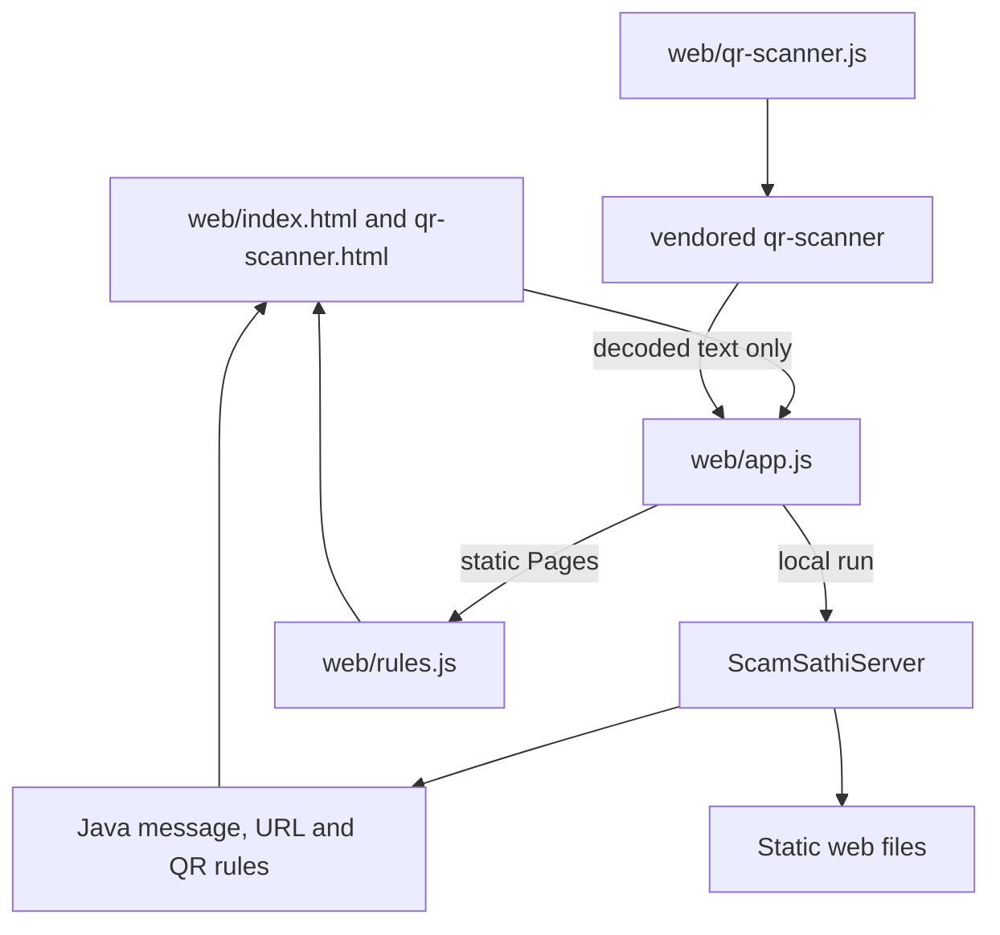

# Architecture

## Runtime modes

**Local mode:** `run.bat` or `run.sh` compiles Java 17 source and starts `ScamSathiServer` on loopback. The browser posts form-encoded message/URL input to `/api/analyze` and decoded QR text to `/api/qr/analyze`. `/api/health` reports readiness.

**Static mode:** the GitHub Pages workflow deploys only `web/`. `web/app.js` attempts same-origin API calls with a short timeout; when no API exists, it uses `web/rules.js` in the browser. QR camera and image decoding happen on the client through the locally vendored library.

## Data handling

The app accepts only text fields. The local Java API does not write input to disk, log it, fetch the URL, or call an outside service. Client dashboard counts and recent activity labels/times live in JavaScript memory for the current tab. The QR camera feed is decoded in-browser and not sent to the server; only its decoded text is analyzed. The static mode never needs a server API.

## Analysis result

Both engines produce `score`, `level`, `title`, `summary`, `disclaimer`, `signals`, and `actions`; `hasUrl` is internal and omitted by the final result. Each signal has an identifier, label, explanation, and points. The score is a weighted rule tally capped at 100, not a calibrated probability. Java and JavaScript rules are intentionally mirrored; future edits should update both and add parity tests.

## Dependency boundary

Runtime dependency: local `qr-scanner` 1.4.2 source/worker under `web/vendor/qr-scanner/`, MIT licensed. No analytics, fonts, CDN, external API, model download, or cloud inference dependency. See [THIRD-PARTY-NOTICES.md](../THIRD-PARTY-NOTICES.md).
